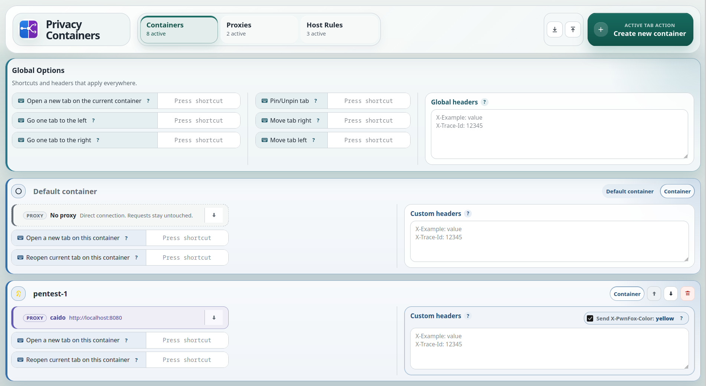
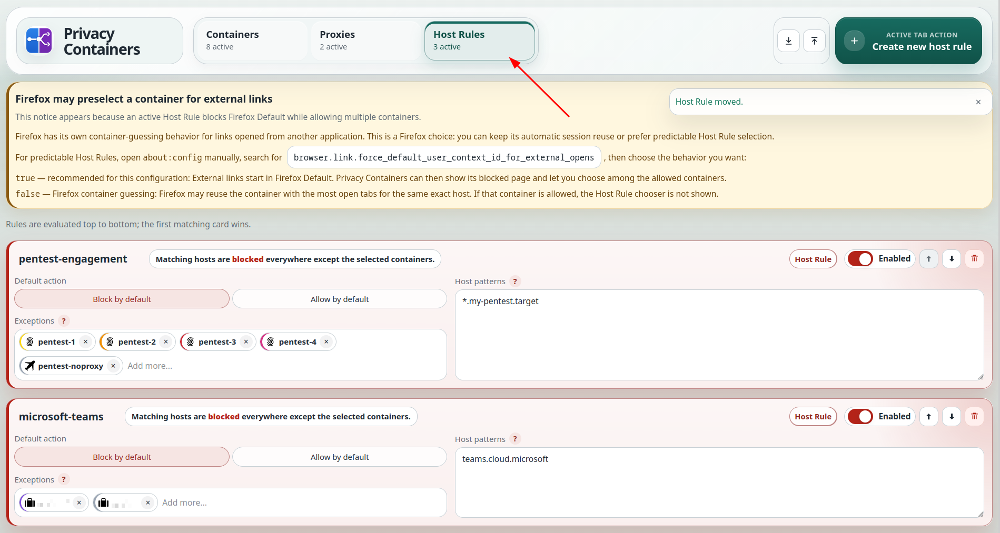
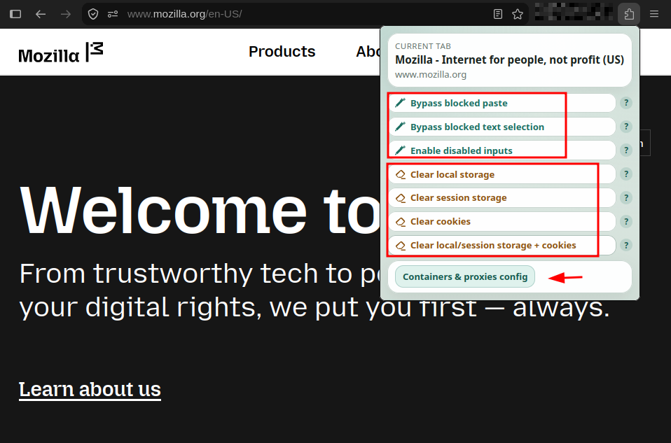

# Privacy Containers

**Your Firefox Containers, proxies, headers, site rules, and shortcuts—all in one place.**

Firefox Containers keep cookies and logins separate, so you can use several
accounts on the same website side by side. Privacy Containers adds control
over how each container connects and which sites it can access.

Compare an admin session with a regular user session during a pentest. Send
one through Burp Suite, Caido, or OWASP ZAP while another connects directly.
Keep personal accounts in separate containers, with their own settings.

**[Install Privacy Containers for Firefox](https://addons.mozilla.org/addon/privacy-containers/)**

## Set up each container for the task

- **Choose its connection.** Connect directly or assign a reusable HTTP,
  HTTPS, or SOCKS proxy. Configure remote DNS, HTTP/HTTPS proxy authentication,
  and bypass rules when needed.
- **Customize its requests.** Add headers globally or per container, including
  the PwnFox-compatible `X-PwnFox-Color` header.
- **Keep sites in the intended containers.** Use Host Rules to allow or block
  sites by container. For example, restrict a client's target hosts to its
  test containers. If a link is blocked, reopen it in an allowed container.
- **Reach the right session from the keyboard.** Give containers shortcuts
  to open new tabs or reopen the current tab in them. Configure shortcuts
  to switch, move, and pin tabs too.
- **Reuse your setup.** Export and import settings as JSON.

Manage containers for different accounts, roles, or clients from the same
configuration page. Each can use its own route, headers, and shortcuts.

## Check the current page and act on it

See the current tab's container, main-page route, matching Host Rule, cookie
count, and effective custom headers in the toolbar popup. Follow linked
names to open the relevant settings.

The popup also gives you quick tools to:

- clear the current page's cookies, local storage, or session storage;
- restore blocked paste or text selection;
- re-enable disabled form fields.

Reset a test session or interact with a restricted form without opening
developer tools for these common tasks.

## Get started

1. [Install the extension](https://addons.mozilla.org/addon/privacy-containers/).
2. Open the toolbar popup and select **Containers & proxies config**.
3. Create or reuse a Firefox Container. Assign a proxy if needed, or leave
   it on a direct connection.
4. Open a tab in that container. Its route applies immediately.

Add headers, Host Rules, and container shortcuts from the same page as needed.

## Privacy

No account, telemetry, cloud service, or remotely loaded code. Settings stay
in Firefox unless you export them. Only containers assigned to a proxy use it.

## Requirements and license

Requires desktop Firefox 142 or later with Firefox Containers enabled.

Released under the [Mozilla Public License 2.0](LICENSE).
