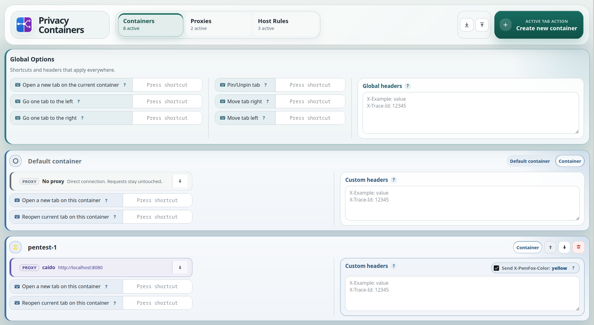
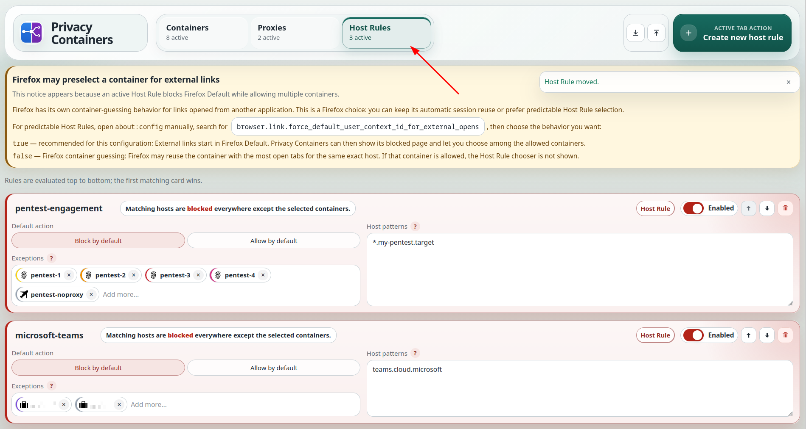
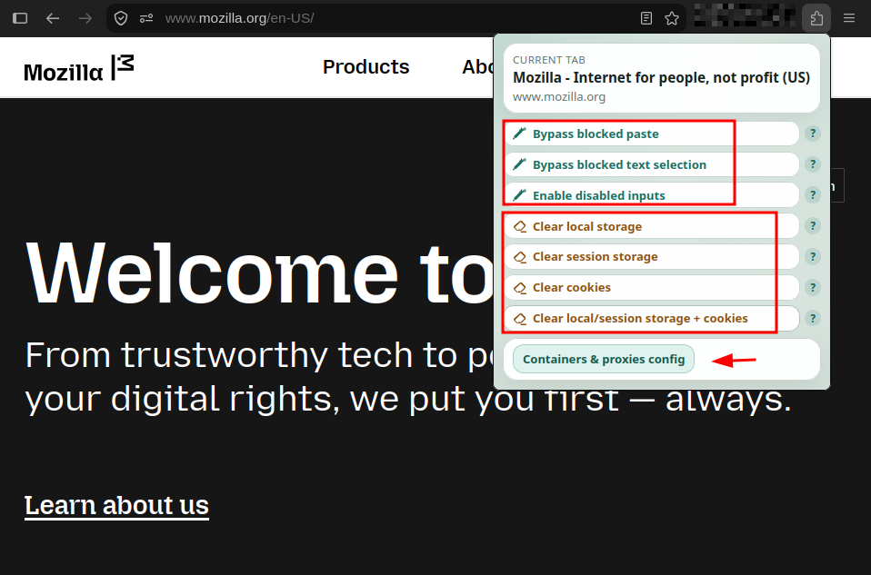

# Privacy Containers

**Separate Firefox sessions, with a proxy and rules for each container.**

Test a site through an intercepting proxy in one container, stay signed in to
another account in a second, and browse normally in a regular tab. Set the
route, request headers, and site access rules for each container.

[Get Privacy Containers for Firefox](https://addons.mozilla.org/addon/privacy-containers/)

## What it does

- Give each container a direct connection or a reusable HTTP, HTTPS, or SOCKS
  proxy. Add remote DNS, HTTP/HTTPS authentication, and bypass rules when needed.
- See at a glance which tabs have a proxy assigned, then check the current
  page's route in the popup.
- Add request headers globally or per container, including the PwnFox-compatible
  `X-PwnFox-Color` header.
- Use Host Rules to allow or block sites by container. Reopen a blocked link in
  an allowed container.
- Open or reopen tabs in a chosen container. Set shortcuts for those actions,
  or to switch, move, or pin tabs.
- Export and import settings as JSON.

## Useful tools in the popup

The popup shows the current tab's container, main-page route, matching Host
Rule, cookie count, and effective headers. Click a linked name to open its
settings.

For the current page, you can also:

- bypass blocked paste or text selection;
- re-enable disabled form fields;
- clear local storage, session storage, or cookies.

## Get started

1. Open **Containers & proxies config** from the toolbar popup.
2. Create or reuse a Firefox Container, then assign a proxy if you need one.
3. Open a tab in that container. Its route applies immediately.

Add headers, Host Rules, and shortcuts as needed.

## Privacy

There is no account, telemetry, cloud service, or remotely loaded code. Settings
stay in Firefox. Only containers you assign to a proxy use it.

## Requirements and license

Requires desktop Firefox 142 or later with Firefox Containers enabled.

Released under the [Mozilla Public License 2.0](LICENSE).
